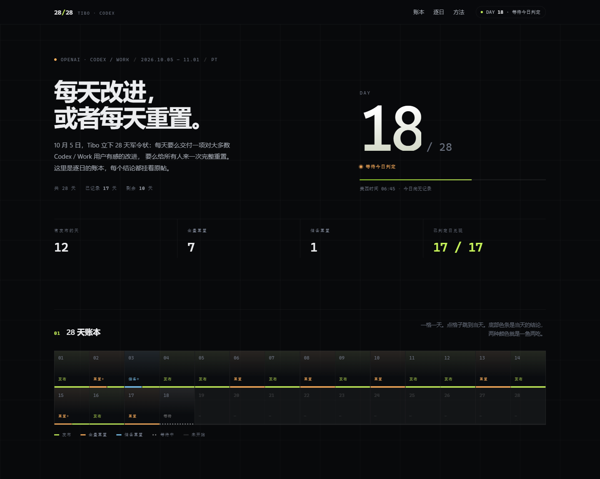

# 28/28 — Tibo 的 28 天

一个零依赖的静态追踪站，逐日记录 [@thsottiaux](https://x.com/thsottiaux) 的 28 天承诺：
**每天要么交付一项对大多数 Codex / Work 用户有感的改进，要么做一次完整重置。**

2026.10.05 — 11.01，共 28 天。站点按日期自动推进，结束后自动变成完整战报。

**正式方案跑在 GitHub Actions 上**：每天云端同步 → 自动提交 → Pages 重新发布，
不依赖任何一台电脑开着。



---

## 本地预览

双击 `index.html` 即可，不需要装任何东西。想用本地服务器：

```bash
python -m http.server 8756
# http://127.0.0.1:8756/
```

## 结构

```
index.html            页面骨架（静态文案 + 数据绑定占位）
styles.css            全部样式（设计 token 在 :root）
app.js                渲染、筛选、键盘导航、实时 PT 时钟
data/days.js          手写数据：window.CHALLENGE + window.DAYS（校订过的记录）
data/auto.js          自动同步写入：window.AUTO_DAYS（同一天以 days.js 为准）
tools/sync.mjs        每日同步：追踪页 + X 原帖正文 + 模型摘要 → 写 auto.js
tools/validate.mjs    数据校验（连续 28 天、日期、链接、字段）
tools/qa.mjs          结构与交互自检（需要 DevTools 端口）
tools/shot.mjs        整页截图（走 CDP，用于走查）
tools/optional/       备用方案：本机 Windows 计划任务（默认不用）
.github/workflows/    sync.yml：每天定时同步并提交
.nojekyll             Pages 不做 Jekyll 处理
shots/                README 用的两张截图
```

## 部署到 GitHub（主路径）

本机还没装 Git 的话先装一个（GitHub Desktop 也行）：

```powershell
winget install --id Git.Git -e --source winget
```

然后在项目根目录：

```bash
git init -b main
git add .
git commit -m "28/28: Tibo 的 28 天追踪站"
git remote add origin https://github.com/<你的账号>/28-28.git
git push -u origin main
```

`.env` 在 `.gitignore` 里，不会被提交；提交前可以用 `git status` 确认一遍。

**打开 Pages**：仓库 Settings → Pages → Source 选 `Deploy from a branch` → `main` / `(root)` → Save。
地址是 `https://<你的账号>.github.io/28-28/`。

**加模型密钥**：Settings → Secrets and variables → Actions → New repository secret，
名字 `LLM_API_KEY`，值就是 `sk-...`。可选在 Variables 里加 `LLM_BASE_URL` / `LLM_MODEL`，
不加则默认 DeepSeek（`https://api.deepseek.com/v1` + `deepseek-chat`）。

**手动跑一次**：Actions → sync → Run workflow，看日志里有没有写进新的天。

## 每天自动跑（GitHub Actions）

`.github/workflows/sync.yml` 每天 **UTC 02:00 / 14:00**（北京 10:00 / 22:00）执行：

1. `tools/sync.mjs` 抓追踪页 → 取原帖正文 → 调模型写摘要 → 写 `data/auto.js`；
2. `tools/validate.mjs` 不通过就整次失败，不会提交坏数据；
3. 有变化才 commit + push，Pages 随即重新部署。

几个要知道的点：

- cron 是 UTC，高峰期可能延迟几分钟；
- 公开仓库的定时工作流在 60 天没有提交后会被自动停用，这里每天都有提交，不受影响；
- 失败会在 Actions 页面留下红色记录，也可以在 Settings → Notifications 打开失败邮件；
- 没有配 `LLM_API_KEY` 也能跑，只是摘要留空标「待补」。

## 手动补一天

自动抓的只覆盖「能解析到的结论」。想改措辞、补细节，就往 `data/days.js` 里写一条，
同一天手写优先，页面立刻切过去：

```js
{
  day: 18,
  date: "2026-10-22",          // 必须是 PT 日期，且等于 startDate + (day-1)
  kinds: ["reset", "ship"],    // ship | reset | banked，可多选
  title: "一句话标题",
  url: "https://x.com/thsottiaux/status/...",
  summary: "两三句中文说明，讲清楚改了什么、对谁有用。",
  quote: "Reset 帖的英文原话（可选）",
  quoteZh: "中文翻译（可选）",
  items: [],                   // 一天多条时才需要
  reactions: { praise: 2191, meh: 152 },
  tags: ["缓存"],
  note: null
}
```

改完跑 `node tools/validate.mjs`，再提交。

口径：

- `ship` 发布、`reset` 全量重置、`banked` 储备重置（可留存、按需使用的那张）；
- 同一天两件事都发生，两个 kind 都写，统计各算一次，页面标「双」；
- 页面上的数字全部由 `app.js` 从数据算，不要手改 `index.html`。

## 自动摘要

同步时会调一个 OpenAI 兼容接口，写 1–2 句中文摘要和标签：

| 服务 | LLM_BASE_URL | LLM_MODEL |
|---|---|---|
| DeepSeek（默认） | `https://api.deepseek.com/v1` | `deepseek-chat` |
| OpenAI | `https://api.openai.com/v1` | `gpt-4o-mini` |
| 本地 Ollama | `http://127.0.0.1:11434/v1` | `qwen2.5:7b` |

本地调试用 `.env`（复制 `.env.example`）；线上用仓库 Secret。
脚本按顺序读 `~/.28-28.env`、项目 `.env`，都不存在就用环境变量（Actions 走这条）。

开关：

- `--no-llm`：这次不调模型；
- `--fill`：给已有但没摘要的自动记录补摘要（每次最多 5 条）；
- 调用失败不会中断同步，摘要留空、页面显示「待补」，数据照样落库。

页面上的自动记录带「自动」标签；摘要由模型生成时脚注写「摘要由模型整理，可校订」。

## 备用方案：本机计划任务

不想用 GitHub、只想这台电脑跑：

```powershell
powershell -ExecutionPolicy Bypass -File tools\optional\install-task.ps1 -DryRun   # 先看会注册什么
powershell -ExecutionPolicy Bypass -File tools\optional\install-task.ps1           # 注册（默认 10:00 / 22:00）
powershell -ExecutionPolicy Bypass -File tools\optional\install-task.ps1 -Remove   # 取消
```

代价是：电脑休眠或关机就不跑，`InteractiveToken` 下还要你已登录。日志在 `logs\sync.log`（已 gitignore）。

**切到 GitHub 之后，记得把之前注册的两个任务删掉**，否则本地和云端会各写一份 `data/auto.js`，下次 pull 容易冲突：

```powershell
schtasks /Delete /TN "28-28 sync" /F
schtasks /Delete /TN "28-28 sync 2" /F     # 若当时注册了 22:00 那个
```

`logs\` 目录可以留作历史，也可以直接删。

## 校验与自检

```bash
node tools/validate.mjs
```

检查：day 从 1 连续、date 与 startDate 对得上、kinds 合法、标题/摘要不为空、X 链接格式正确、
reactions 是数字。有任何问题退出码为 1。

交互自检需要一个开着的 DevTools 端口（开发时用）：

```bash
node tools/qa.mjs <debugPort> http://127.0.0.1:8756/
```

## 口径与声明

- 判定以 Tibo 的 X 原帖为准，每条记录都挂原帖链接；中文摘要为本站整理或模型生成。
- 互动数是 X 上的「鼓掌 / 无感」比例，**不是满意度**——重置帖天然高赞，读的时候要带上这个偏差。
- 日期统一用美西时间（PT），Tibo 发帖时间不固定，所以「等待判定」可能出现在一天里的任何时刻。
- 本站是非官方记录，与 OpenAI、Tibo 本人无关。欢迎纠正数据。
- 数据截至 **2026.10.21（PT）**，第 17 天为自动收录。
